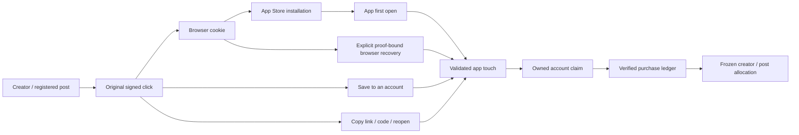

# First-party creator attribution implementation

> Update — October 22: per-post registration has been retired at the user’s request. Creators reuse the existing account link/code across posts. The “Track your post from the start” panel and code/CTA generator are removed; cached registration requests receive HTTP 410. Previously shared URLs and their historical attribution remain valid. The account-level identity/recovery/billing system is unchanged. Earlier post-registration details below describe the original release.

This replaces the phased proposal with implemented work across all six areas. The original audit remains a historical, read-only snapshot in `creator-attribution-plan-2026-10-21.md`; its estimates and rollout suggestions are not the current implementation status.

## What changed

| Area | Implemented behavior |
| --- | --- |
| Diagnostics | Production-safe engine events; separate browser, native-link, code, browser-recovery and account-recovery evidence; truthful first-open observations rather than invented installs. |
| Capture and iPhone continuity | Original signed-link copy before App Store; explicit browser recovery with state, SHA-256 proof, expiring opaque tickets and same-install retry; account save/recovery; paste/code/reopen fallback; creator saving independent of discount loading. |
| Verified revenue | One projection from normalized Stripe/RevenueCat financial facts; acquisition-time eligibility; frozen subscription ownership; exact partial reversals; deduplication; bounded existing-platform cron reconciliation and actionable unmatched reasons. |
| Post identity | Reserve a post code/link before publication using the existing submission row; generated caption/CTA SVG; record publication URL/caption/time at any view count; promote that same row for paid review. Drafts cannot be approved or paid. |
| Reporting | Verified ledgers replace manually entered funnel economics. Source/method, post coverage, billing reasons and unknown groups remain visible. Stable App Store campaign tokens plus idempotent CSV/TSV import preserve suppressed values and separate currencies. |
| Content and ongoing observation | Creator tools support exact per-post caption codes, early CTA assets, post timestamps and durable post-to-purchase joins. These observations support future evaluation immediately; no fabricated experiment result or automatic platform scrape is claimed. |

## iPhone connection

The App Store installation itself supplies no browser-to-app identity edge. Recovery, account login, and explicit link/code entry establish that connection.

The browser cookie does not cross an App Store installation into the app automatically. Our explicit browser recovery asks the OS to revisit Mogging in a browser session, then returns a proof-bound ticket to the initiating app. If that session has neither the referral cookie nor a saved account, it offers a pasted code/link or reopened link. TikTok/Instagram embedded cookies can remain isolated. Account recovery retrieves a previously saved referral after login. Copy/paste and browser recovery preserve the original click; code entry is separately labeled evidence.

There is no new paid link provider, hidden clipboard probe, fingerprinting, or guarantee of universal anonymous matching. Existing optional paid-media SDK code is independent. All creator accounts use the same first-party path; no pilot allowlist limits recovery.

## Financial rule

Eligible evidence must exist before the original purchase, and its click must fall within the preceding 30 days. The selected acquisition is frozen for renewals/refunds. A newly entered code cannot retrospectively take an old purchase. Sandbox/internal accounts are excluded from customer economics. Apple campaign aggregates never become individual ownership or payout evidence. Unknown attribution stays unknown.

Historical clicks receive the migration’s default browser source; their pre-release method cannot be reconstructed reliably. New sources/methods are explicit. Post captions and times are creator-reported until reviewed. Original video ingestion and permissioned social-platform metric refresh are not implemented by this release. Existing analytics recordings/public post links remain available for human review. This limitation is separate from the completed referral and billing path.

## Verification

- Web: main source 128 test files with the sole sandbox-restricted localhost listener rerun successfully. The isolated release passes all 127 test files with an explicit local test database and dummy auth secret. Both TypeScript and production builds pass. The isolated snapshot’s two outdated test fixtures were synchronized after promotion; these change no runtime code.
- Mobile: repository `bun run test` passes 303 tests; isolated browser transport adds five proof/state/cancel/missing-cookie checks. `bun test` without repository scoping can mix native SDK mocks; use the defined command.
- Real PostgreSQL: 23 checks covering prepublication identity, ownership, expiry/replay, concurrent resolve, cross-device account recovery, verified allocation/deduplication, frozen renewals, exact partial refunds, late-code rejection, cron reconciliation, post joins and campaign imports.
- Real localhost HTTP: landing HttpOnly cookie → fixed browser callback → proof redemption → original signed click; same-install retry, wrong proof and cross-install rejection; missing cookies and malformed requests.
- Native: Xcode Simulator build and launch succeed after restoring absent same-version Skia simulator libraries. Settings recovery opens the OS consent/session, returns actionable missing-cookie guidance, and explicit code entry reaches the server-confirmed “Creator referral saved” state. Screenshot: `artifacts/creator-attribution-2026-10-21/iphone-referral-saved.jpg`. This does not replace physical-device Safari/social-browser/App Store testing.
- Local web UI: creator landing, code copy, and recovery/install actions inspected; screenshots are in the audit artifact directory.

## Release contract

Migrations `0055_creator_continuity` and `0056_creator_store_campaigns` are additive. Run each with `bun run db:migrate --only <tag>` before promoting the matching server build. Do not run unrelated pending migrations. Database connections explicitly use UTC because existing timestamp columns are timezone-naive UTC.

A separate source snapshot `.local/creator-continuity-release` overlays 47 explicit attribution files on the isolated reliability repair rather than publishing the entire dirty checkout. The allowlist/hash manifest is `.local/creator-continuity-review/overlay-manifest.json`. Coordinate promotion with the repair chat to preserve its scan/auth/push/Stripe fixes. Backend rollout precedes the mobile release. New browser recovery requires the updated mobile binary; old versions retain code/reopen support.

The server cron reconciles up to 100 durable facts within a 45-second work budget every five minutes, retries unresolved cases after 15 minutes, limits lookback to 90 days, and removes expired recovery tickets after a day. It uses the existing `CRON_SECRET`. No client token or credential enters diagnostics.

**Production status:** migrations 55/56 applied with scoped commands, then initial deployment `dpl_5EZRBV68hqqbtSh6YNXAkbXKQ3za` promoted after full deployed continuity checks. Final deployment **`dpl_CAWrh9q6RjG3ECFifx7oxjrFAjMJ`** (`https://mogging-i8xjnebf7-glimpseback.vercel.app`) is promoted to **`https://www.mogging.com`**, adding the tested 45-second reconciliation budget and verified Apple provider configuration. Required production build/health checks passed. Deployed HTTP checks pass for original signed-cookie capture, proof-bound browser recovery, replay/ownership rejection, mobile claim/account recovery, idempotent paywalls, desktop signed entry, canonical Google origin and auth boundaries. Disposable internal fixtures were removed; production audit confirms zero remain. Public health, account auth, missing-cookie callback and cron auth checks pass.

The updated mobile binary is built and tested locally, including native Settings code-save confirmation and OS recovery fallback. It has not been distributed through TestFlight/App Store. Physical iPhone App Store and embedded-browser continuity remain acceptance work; do not label this universal automatic install matching.

**Apple reporting configuration:** the account’s public provider token was recovered from its signed-in App Store Connect campaign generator. `APPLE_APP_STORE_PROVIDER_TOKEN` is configured in Production as Config, and all 94 active creator destination URLs now contain the verified token; other query parameters were preserved in an atomic update with a rollback snapshot. Public destination validation checks the correct Mogging app ID, provider token and stable creator campaign. Campaign aggregates are per creator/account, while individually recovered clicks carry exact submission identity. Per-video Apple download campaigns are not implemented. Actual aggregate reports remain subject to Apple thresholds/delay and an authorized export/import; configuration success is not download evidence. Apple campaign exports still require obtaining an authorized export and importing normalized columns (`date,campaign,territory,downloads,sales,currency`); there is no new external subscription or configured automatic Apple export job.

The first scheduled production reconciliation completed successfully in **39,877 ms** on the initial release. The follow-up adds a 45-second soft budget so remaining durable facts defer safely instead of risking the 60-second function limit as volume grows.
